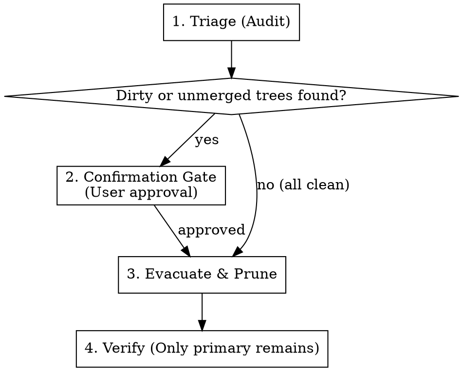

# Clean Worktrees

Safely audit, evacuate, and prune linked Git worktrees across the repository without losing uncommitted work or leaving orphaned directory clutter.

**Core principle:** Triage first → Gate on risk → Evacuate & prune → Verify primary-only.

## When to Use

* Accumulation of subagent or tool worktrees (`.gemini/...`, `.claude/worktrees/...`, `~/orca/...`, `.worktrees/...`).
* Reclaiming disk space and reducing Git index clutter.
* User commands like "워크트리 정리해줘", "모든 워크트리 삭제", "clean up worktrees", or `/clean-worktrees`.

## When NOT to Use

* Finishing a *single* branch workflow (use `finishing-a-development-branch` instead).
* The user explicitly wants to keep active background subagents running in their workspaces.

---

## 4-Step Cleanup Pipeline

Follow these steps in strict sequence. Do not skip steps.



### Step 1: Triage (Audit)

Enumerate all linked worktrees and inspect their risk profile.

Run the bundled audit tool (recommended):
```bash
python3 ~/.gemini/config/skills/clean-worktrees/scripts/clean_worktrees.py --cwd .
```
Or run the manual audit:
```bash
git worktree list --porcelain
```

For every linked worktree (skip index 0 / primary repo):
1. **Working directory state**: Check `git -C "<path>" status --porcelain -uall` (`Clean` vs `DIRTY`).
2. **Branch state**: Check if the branch has unmerged commits (`git rev-list --count main..<branch>`).

> **Completion criterion**: A structured summary table is produced showing:
> - Index & Path
> - Attached Branch / Detached HEAD
> - State (`Clean` vs `DIRTY`)
> - Unmerged commit count relative to the base branch (`main`)

---

### Step 2: Confirmation Gate (Safety Check)

Evaluate the triage report before touching anything on disk:

* **If ALL linked worktrees are `Clean` and have 0 unmerged commits**: Proceed directly to Step 3.
* **If ANY worktree is `DIRTY` (contains uncommitted edits or untracked files)**:
  * **STOP**. Do NOT use `--force` silently.
  * Show the list of modified/untracked files to the user.
  * Ask for consent:
    1. Discard uncommitted changes with `--force`
    2. Keep specific worktrees intact
* **If unmerged commits exist on a branch**: Remind the user that worktree removal retains the git branch (`refs/heads/...`), so commit history is not lost.

> **Completion criterion**: Explicit approval obtained if any dirty tree or destructive discard is required.

---

### Step 3: Evacuate & Prune

Remove linked worktrees and clean up directory sediment.

Run the automated executor:
```bash
# For clean trees:
python3 ~/.gemini/config/skills/clean-worktrees/scripts/clean_worktrees.py --cwd . --execute

# If user approved force-removing dirty trees:
python3 ~/.gemini/config/skills/clean-worktrees/scripts/clean_worktrees.py --cwd . --execute --force
```

Or execute manually:
```bash
# 1. Remove each linked worktree
git worktree remove "<worktree-path>"
# Use --force ONLY if confirmed in Step 2:
# git worktree remove --force "<worktree-path>"

# 2. Prune stale worktree metadata
git worktree prune -v

# 3. Clean empty parent container folders
rmdir .claude/worktrees 2>/dev/null || true
rmdir .worktrees 2>/dev/null || true
```

> **Completion criterion**: All target linked worktree paths are unlinked, `git worktree prune` has executed, and empty parent container folders are removed.

---

### Step 4: Verification

Verify that the repository state is clean and no orphan worktrees remain.

Execute:
```bash
git worktree list
```

> **Completion criterion (HARD GATE)**:
> Output MUST contain **exactly one line** — the primary repository root.
> If any linked worktree remains, investigate why it was skipped and do not declare completion.

---

## Red Flags & Failure Modes

| Thought / Action | Reality | Correct Behavior |
|---|---|---|
| "I'll just pass `--force` to remove everything quickly." | Destroys uncommitted code or active subagent work permanently. | Triage first. Only `--force` after user approval. |
| "Removal is done, no need to prune." | Leaves phantom worktrees in `.git/worktrees`. | Always run `git worktree prune`. |
| "The script failed with `Operation not permitted`." | Sandboxing blocked access to `.git/worktrees` or external directories. | Run command with environment bypass or request sandbox permission. |
| "I removed the worktrees, but left empty `.claude/worktrees` folder." | Sediment clutters `git status` as untracked folders. | Clean up empty parent container folders. |
| "I can skip verification since the loop finished." | Premature completion. Some trees may have failed to delete. | Always verify with `git worktree list`. |
