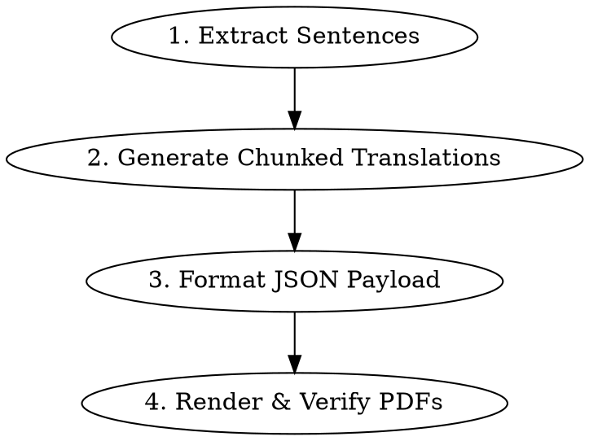

# Exam Worksheet Generator

Extract core sentences from mock/CSAT exam PDFs, generate phrase-by-phrase slash-chunked translations (`/`), and compile them into minimalist, single-page A4 test and answer sheet PDFs.

## Workflow



### Step 1: Extract Sentences by Criteria
Scan the exam paper and extract key sentences based on the finalized session criteria.

#### Default Extraction Policy (기본 발췌 규칙: 총 10문항)
If no specific questions or custom criteria are requested by the user, **extract exactly 10 questions (2 from each of Sessions 1 to 5)** according to the following confirmed mappings:

1. **세션 1: 읽기 기초 (18번 ~ 20번)**
   - **18번 (글의 목적)**: 필자의 용건이나 핵심 요청이 담긴 대표 문장 (`I am writing to...`, `We would appreciate...` 등) 1문장
   - **20번 (필자의 주장)**: 당위 표현(`must`, `should`, `need to`, `essential`)이 포함된 결론부 핵심 주장 1문장
2. **세션 2: 대의 파악 및 간접 말하기 (22번 ~ 23번)**
   - **22번 (글의 요지)**: 지문의 요지가 집약된 주제문(Topic Sentence) 1문장
   - **23번 (글의 주제)**: 역접/인과 연결사(`However`, `Therefore`) 뒤에 이어지는 필자의 핵심 논지 1문장
3. **세션 3: 도표 / 내용 일치 / 안내문 (25번 ~ 28번)**
   - **25번 (도표)**: 비교급/최상급, 배수사(`twice as many...`), 증감 표현이 포함된 복합 구문 1문장
   - **26번 (인물 일치)**: 관계사 및 분사구문이 포함된 인물의 생애/업적 서술 복합문 1문장
4. **세션 4: 어법 및 빈칸 추론 (29번, 31번)**
   - **29번 (어법)**: 복합 관계사, 수일치, 능수동 등 핵심 구문 문장. **★틀린 어법 보기는 올바른 정답 형태로 교정하여 완성형 문장으로 추출**
   - **31번 (빈칸 추론)**: 빈칸이 포함된 핵심 문장. **★빈칸에 정답 단어를 채워 넣은 완전한 문장으로 추출**하여 온전한 구문 해석 훈련 제공
5. **세션 5: 간접 쓰기 / 유형 문제 (35번 ~ 40번)**
   - **36번 (글의 순서)**: 지시어, 대명사, 연결사가 포함되어 문맥 연결의 핵심 고리가 되는 문장 1문장
   - **38번 (문장 삽입)**: 글의 흐름 전환 단서가 되는 박스 제시문 또는 핵심 연결 문장 1문장

*(참고: 세션 6 복합 지문 43~45번은 기본 5개 세션 외 옵션 세션으로, 사용자 요청 시에만 추가/대체 적용)*

#### Quality & Filtering Standards
- **Word Count**: 12 ~ 38단어 내외 (A4 1페이지 2줄 손글씨 공간 최적화).
- **Quote Format**: 반드시 원본 문항 번호를 명시 (예: `[18번] "..."`, `[29번] "..."`).
- **Completion Criterion:** All 10 session-based target questions have exactly 1 high-value sentence extracted.

### Step 2: Generate Slash-Chunked Translations (직독직해)
Translate each extracted sentence into Korean, segmenting by syntactic/meaning chunks (subject, predicate, modifiers) separated by `/`.
- Format: `[주어/서술어 단위] / [수식어구 단위] / [목적어/보어 단위]`
- Example: `"이것은 매우 인기 있는 행사이다 / 우리 지역 사회에서 / 그리고 우리는 당신이 올해 대회에 참가하기를 요청하고 싶다."`
- **Completion Criterion:** Every sentence has an accurate, natural chunked translation with clear slash boundaries.

### Step 3: Format JSON Payload
Save the extracted data into a temporary JSON file (`data.json`) structured as:
```json
{
  "title": "영어 해석 시험 0821",
  "questions": [
    {
      "num": "[18번]",
      "en": "It is a very popular event in our community, and we would like to ask you to join the competition this year.",
      "ko_chunks": "이것은 매우 인기 있는 행사이다 / 우리 지역 사회에서 / 그리고 우리는 당신이 올해 대회에 참가하기를 요청하고 싶다."
    }
  ]
}
```

### Step 4: Render & Verify PDFs
Execute the bundled generator script to produce the test sheet and answer key PDFs:
```bash
/opt/homebrew/bin/python3 <skill-dir>/scripts/generate_worksheet.py /path/to/data.json --test-out test_sheet.pdf --ans-out answer_sheet.pdf
```
- **Completion Criterion:** 
  1. Both `test_sheet.pdf` and `answer_sheet.pdf` exist.
  2. Each PDF is verified via regex or PDF inspector to be **strictly 1 page (A4)**.

---

## Design Standards

All generated worksheets must comply with the layout specifications in [layout-rules.md](references/layout-rules.md):
- **Layout**: Single-column vertical arrangement.
- **Style**: Minimalist black and white (no color blocks, 1pt solid header rule, 0.4pt subtle separators).
- **Typography**: System default Korean Gothic font (`AppleGothic` / `NanumGothic`).
- **Handwriting Space**: 2-line clean underline blanks for student handwriting per question.
- **Vertical Justification**: Automatically distributes question gaps to fill the entire A4 page vertically with generous header bottom margin.
